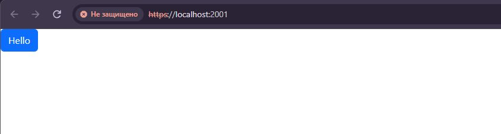
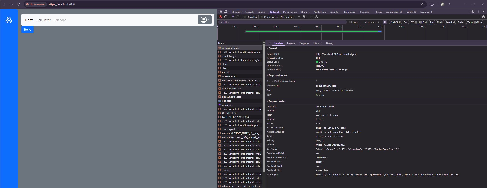

## Main-project
Проект созданный с использованием библиотеки `react` и сборщика `vite`.
Причиной создания проекта стало желание попробовать и освоить технологию для реализации микро-фронтенда.
Инструментом для реализации был выбран пакет `module-federation/vite` т.к. с `vite` у меня больше всего опыта использования.

Основной идеей является создание некого хаба, который будет содержать в себе основной роутинг, стили и необходимые данные(фейк сервер).
На данный момент реализовано только подключение и получение данных из [тестового приложения](https://github.com/sominiac/calendar).

Запускается всё просто, можно опробовать самостоятельно:

- развернуть main репозиторий
- развернуть тестовый репозиторий
- установить, в обоих развёрнутых проектах, пакеты зависимостей
- первым запустить тестовый проект (script/dev)
- вторым запустить main проект (script/dev)

### Результат должен быть следующим:

Скрин тестового проекта на 2001 порту:

Скрин основного проекта на 2000 порту:

### Что планируется сделать:

- Доработать цветокор и основные стили проекта.
- Добавить прокидывание необходимых данных в импортируемые проекты.
- Добавить вместо тестового проекта, проект из [репозитория](https://github.com/sominiac/vue-calculator).
- Реализовать и добавить проект календаря.